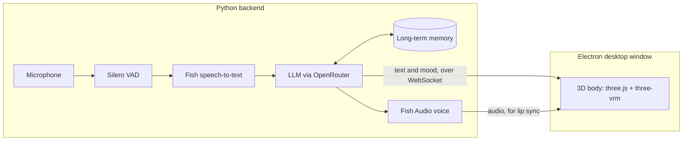

<h1>Hi  My name is Thinh Nguyen</h1>

I'm a student at Rutgers University building real-time AI software. My main project, Remielle, is a voice AI companion: a Python backend that streams LLM replies, listens, speaks and remembers, driving a three.js 3D character in an Electron desktop app over WebSockets, with her animation fitted to timing measured in reference footage.

* 🌍 I'm based in New Jersey
* ✉️ You can contact me at [thinh.nguyen19042803@gmail.com](mailto:thinh.nguyen19042803@gmail.com)
* 🚀 I'm currently working on [Project Remielle](#project-remielle)
* 🧠 I'm learning to make LLM apps reliable: streaming replies, voice barge-in, and regression tests for model behavior
* 💼 Open to software engineering internships: generative AI / LLM apps, full-stack, backend, three.js / WebGL

  <picture>
    <source media="(prefers-color-scheme: dark)" srcset="https://raw.githubusercontent.com/Stellar1M/Stellar1M/main/assets/terminal-dark.svg" />
    <source media="(prefers-color-scheme: light)" srcset="https://raw.githubusercontent.com/Stellar1M/Stellar1M/main/assets/terminal-light.svg" />
    
  </picture>

### Project Remielle

  

A personal AI companion modeled on **Remielle Dan** from *Zenless Zone Zero*. I'm building it step by step, wiring the models together myself, to learn how AI apps really work: a language model for a brain, a synthesized voice, speech recognition, long-term memory, and a 3D body that moves and reacts.

  
  &nbsp;&nbsp;
  

Two of her outfits, straight from the app's 3D view (three.js + three-vrm).

**What she can do today**

* 🧠 **Brain**: a large language model through OpenRouter. Replies stream in, so she starts talking a couple of seconds after I stop.
* 🗣️ **Voice**: Fish Audio text-to-speech. Her pace and the little sounds before she speaks follow her mood.
* 👂 **Ears**: microphone, Silero voice detection and Fish speech-to-text. I can talk over her, and she reacts while I talk with small sounds and nods.
* 💾 **Memory**: she remembers what we talked about across days, and the memory stays on my own PC.
* 💬 **Speaks first**: she greets me, checks in after a quiet while, and notices when I'm away or back.
* 👀 **Eyes**: she can look at a window or screen I share, and reacts to the games I play.
* 🪟 **Desktop window**: an Electron window that is transparent, always on top and click-through, in the corner of my screen.
* 🧍 **3D body**: a VRM model in three.js with lip sync, blinking, eye contact, moods, and little moments of her own (a wing stretch, a hum, a look around).

<b>How it fits together</b>

**What I'm working on now**

Making her acting match the game. I measure how her face, head and timing move in Zenless Zone Zero footage, then fit her animation to those numbers. The first version is done, and a second round of fixes (sad, happy, surprise and fluster, eye blinks, a new face on every line) is under way. Next up: hand poses that touch her face and chest, solved in Blender; outfit physics (skirt springs, sleeve cuffs); a wing mesh fix; her idle stance; and switching outfits while she runs.

<!-- Once the GitHub Projects board exists, link it here: **Roadmap:** [Project Remielle board](https://github.com/users/Stellar1M/projects/N) -->

<b>What I've learned so far</b>

* Measure before you believe. I compared Fish's emotion tags against no tag over several takes each, and found no steady difference beyond the normal take-to-take variation. What really changes her delivery is speaking speed and sound tags like a sigh or a chuckle.
* Pausing her on every sound I made felt like buffering. Now she whispers (gets quieter) when I talk over her, and only stops when I say real words.
* At this size, putting every remembered fact in the prompt works better than retrieval.

**Built with** Python, JavaScript, three.js and three-vrm, Electron, Node.js, WebSockets and Git, plus OpenRouter, Fish Audio and Silero VAD.

A fan project, not affiliated with HoYoverse. Zenless Zone Zero and Remielle Dan belong to HoYoverse. The 3D model is a fan edit of the official model by 杏子酱Kyouko, used locally and never redistributed, so only screenshots appear here. The source code is in a private repository for now.

### Skills

<a href="https://threejs.org/" target="_blank" rel="noreferrer"><picture><source media="(prefers-color-scheme: dark)" srcset="https://raw.githubusercontent.com/Stellar1M/Stellar1M/main/assets/skills/threejs-dark.svg" /><source media="(prefers-color-scheme: light)" srcset="https://raw.githubusercontent.com/Stellar1M/Stellar1M/main/assets/skills/threejs.svg" /></picture></a>

### GitHub stats

  
  

<!-- These two cards only count public activity. Project Remielle is a private repo, so they stay small until
"Include private contributions on my profile" is switched on (GitHub settings, Public profile). Top languages card
removed: it showed "No languages data." because my public repos have no code yet. Add it back once one does:

-->

### Socials

 <a href="https://www.github.com/Stellar1M" target="_blank" rel="noreferrer"> <picture> <source media="(prefers-color-scheme: dark)" srcset="https://raw.githubusercontent.com/danielcranney/readme-generator/main/public/icons/socials/github-dark.svg" /> <source media="(prefers-color-scheme: light)" srcset="https://raw.githubusercontent.com/danielcranney/readme-generator/main/public/icons/socials/github.svg" />  </picture> </a> <a href="http://www.instagram.com/stellar1m/" target="_blank" rel="noreferrer"> <picture> <source media="(prefers-color-scheme: dark)" srcset="https://raw.githubusercontent.com/danielcranney/readme-generator/main/public/icons/socials/instagram-dark.svg" /> <source media="(prefers-color-scheme: light)" srcset="https://raw.githubusercontent.com/danielcranney/readme-generator/main/public/icons/socials/instagram.svg" />  </picture> </a> <a href="https://www.linkedin.com/in/thinh-nguyen-4a13082b3/" target="_blank" rel="noreferrer"> <picture> <source media="(prefers-color-scheme: dark)" srcset="https://raw.githubusercontent.com/danielcranney/readme-generator/main/public/icons/socials/linkedin-dark.svg" /> <source media="(prefers-color-scheme: light)" srcset="https://raw.githubusercontent.com/danielcranney/readme-generator/main/public/icons/socials/linkedin.svg" />  </picture> </a> <a href="http://www.medium.com/@thinh.nguyen19042803" target="_blank" rel="noreferrer"> <picture> <source media="(prefers-color-scheme: dark)" srcset="https://raw.githubusercontent.com/danielcranney/readme-generator/main/public/icons/socials/medium-dark.svg" /> <source media="(prefers-color-scheme: light)" srcset="https://raw.githubusercontent.com/danielcranney/readme-generator/main/public/icons/socials/medium.svg" />  </picture> </a> <a href="https://www.x.com/stellar1m" target="_blank" rel="noreferrer"> <picture> <source media="(prefers-color-scheme: dark)" srcset="https://raw.githubusercontent.com/danielcranney/readme-generator/main/public/icons/socials/twitter-dark.svg" /> <source media="(prefers-color-scheme: light)" srcset="https://raw.githubusercontent.com/danielcranney/readme-generator/main/public/icons/socials/twitter.svg" />  </picture> </a> <a href="https://www.twitch.tv/naanosmitee" target="_blank" rel="noreferrer"> <picture> <source media="(prefers-color-scheme: dark)" srcset="https://raw.githubusercontent.com/danielcranney/readme-generator/main/public/icons/socials/twitch-dark.svg" /> <source media="(prefers-color-scheme: light)" srcset="https://raw.githubusercontent.com/danielcranney/readme-generator/main/public/icons/socials/twitch.svg" />  </picture> </a>

